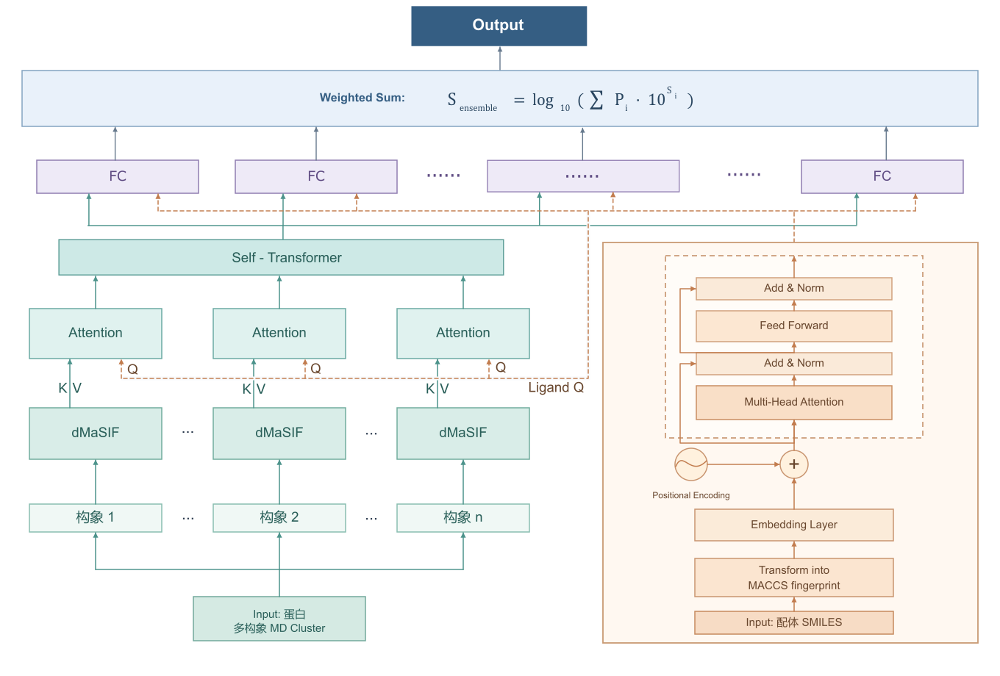

# SICBI 蛋白–配体亲和力预测工具

本项目构建面向蛋白质动态构象集合的蛋白–小分子配体亲和力预测框架。单一静态蛋白结构难以涵盖结合口袋在分子动力学（MD）轨迹中的变化，因此模型同时接收一个蛋白的多个代表性构象和待预测配体的 SMILES。蛋白分支先用固定的预训练 dMaSIF 权重，为各构象的口袋表面生成 16 维 patch 特征；亲和力训练阶段读取这些预计算特征，不反向更新 dMaSIF。配体分支将 SMILES 转成 166 位 MACCS 指纹，并以 Transformer 编码。这一配体指纹 Transformer 及其逐位池化方式主要参考[TEFDTA 工具](https://github.com/RefDawn-XD/TEFDTA)（[论文](https://doi.org/10.1093/bioinformatics/btad778)）。

在两支路融合时，模型将配体表示变成查询向量，对各构象的蛋白口袋 patch 做多头交叉注意力，提取与当前配体相关的局部表面信息，而不是对每个口袋只使用固定的、与配体无关的池化结果。随后，状态自注意力建模不同构象之间的关系，模型分别回归各状态的亲和力，再按 MD 轨迹中各状态的帧数占比进行对数尺度集成。监督标签与最终输出均为 **pKi/pKd 对数尺度**，预测时不做单位转换。



## 方法概览

- **配体分支**：由 SMILES 计算 166 位 MACCS 指纹；每一位经数值与位置嵌入后输入 Transformer，再经 `Linear(256, 2)` 和最后一维最大池化，得到 166 维配体表示。
- **蛋白分支**：每个蛋白包含 1–10 个构象状态（当前模型训练时每个蛋白均包含10个构象状态，没有进行筛选）。各状态的口袋表面 patch 由固定的预训练 dMaSIF 提取 16 维特征。模型以配体表示参与 patch 聚合，再用构象编码器建模状态之间的关系；批处理使用 patch 和状态 mask 排除填充位置。
- **亲和力输出**：对各真实状态预测亲和力，并按状态概率在原始亲和力尺度上加权，最后回到对数尺度：`log10(Σ p_i × 10^s_i)`。其中 `p_i` 为状态概率，`s_i` 为该状态的预测值。

核心实现见 [`src/pipeline.py`](src/pipeline.py)、[`src/Ligand_transformer/`](src/Ligand_transformer/) 和 [`src/affinity/`](src/affinity/)。

## 数据与预处理

训练数据使用 MISATO 的蛋白–配体结构及分子动力学轨迹，按 PDB ID 匹配 LP-PDBBind 的实验亲和力记录，仅保留具有 Ki 或 Kd 标签的小分子配体复合物。预训练 dMaSIF 用于固定的蛋白表面特征提取，不使用本任务的测试集亲和力标签进行更新。轨迹筛选、口袋定义、构象聚类与合并，以及第三方数据来源，详见 [`data/train_data/data.md`](data/train_data/data.md)。使用第三方资源时仍应核对其原始发布页的许可条款。当前处理好的训练、验证、测试用的原始数据已上传至[https://doi.org/10.5281/zenodo.23129260](https://doi.org/10.5281/zenodo.23129260)。

[`data/train_data/manifest.csv`](data/train_data/manifest.csv) 按复合物划分为训练集 6,825 条、验证集 853 条、测试集 853 条，约为 8:1:1。同一复合物的轨迹帧和构象状态保持在同一划分中；划分与去重原则见上述数据说明。`manifest.csv` 包含 `sample_id`、`protein_id`、`protein_path`、`ligand_id`、`ligand_smiles`、`state_prob_path`、`affinity` 和 `split`。NPY 路径相对于 manifest 所在目录解析。

每个蛋白的 `input.npy` 为 `[N, 17]`：首列是状态 ID，其余 16 列是表面 patch 特征；`state_probabilities.npy` 为 `[S, 2]`：状态 ID 与对应概率。模型按 ID 对齐状态并归一化概率。预测数据采用相同格式；[`data/predict_data/manifest_outputtest_wuxi.csv`](data/predict_data/manifest_outputtest_wuxi.csv) 的 `affinity=0.0` 仅是读取接口所需的占位值，不参与预测计算。

## 运行入口以及运行方式

在项目根目录、已准备好依赖和对应 manifest/蛋白 NPY 的环境中，使用当前默认路径运行：

```bash
python train.py
python predict.py
```

**训练**读取 `data/train_data/manifest.csv`，最佳权重保存到 `models/best_model.pt`，损失曲线保存到 `logs/loss_curve_transformer.png`。

当前直接运行训练代码默认使用示例数据,读取`data\train_data\proteins`和`data\train_data\demo_manifest.csv`中准备的示例数据，生成`demo_best_model.pt`和`"demo_logs`作为示例权重和示例数据。数据以及权重仅仅用于演示。如果需要训练完整模型，请下载完整的训练数据。训练的超参数在[`train.py`](train.py)中调整。模型本身的参数可以在[`src\affinity\models\affinity_model.py`](src/affinity/models/affinity_model.py)以及[`src\Ligand_transformer\model.py`](src/Ligand_transformer/model.py)中调整。

**预测**读取 `data/predict_data/manifest_outputtest_wuxi.csv` 和权重，生成 `results/output_wuxi.csv`，`results/output_wuxi.csv`为预测的现货化合物库中共134,686个分子与CB2蛋白的亲和力。训练数据的原始预处理流程与输入来源见 [`data/train_data/data.md`](data/train_data/data.md)。

在训练过程中**训练**、**验证**、**预测**数据统一通过[`data\train_data\manifest.csv`](data/train_data/manifest.csv)读取，每个蛋白对应一个配体。

## 项目文件

| 路径                     | 作用                                                           |
| ------------------------ | -------------------------------------------------------------- |
| `src/`                 | 配体编码、蛋白构象建模、数据读取与亲和力计算                   |
| `data/train_data/`     | 训练 manifest、蛋白 NPY文件 及数据处理说明                     |
| `data/predict_data/`   | 待预测 manifest 与蛋白 NPY文件                                 |
| `train.py`             | 训练、验证及最佳权重保存                                       |
| `predict.py`           | 读取待预测数据，生成蛋白–配体亲和力 CSV                       |
| `model_test.py`        | 在测试划分上计算`r_m²`、`MSE`，并绘制真实值–预测值散点图 |
| `models/best_model.pt` | 最终交付的亲和力模型权重                                       |
| `logs/training.log`    | 最终权重对应的训练记录、种子、硬件与耗时                       |
| `results/`             | 测试散点图与预测结果                                           |
| `environment.yml`      | 项目依赖版本清单                                               |

## 训练、验证与测试

当前训练配置使用 Smooth L1 损失、AdamW 优化器、10% 步数的线性学习率预热与余弦衰减；最大 100 个 epoch，验证集损失连续 6 个 epoch 未改善时早停，并保留验证损失最低的权重。批大小为 4。最终运行的随机种子为 **42**

[`model_test.py`](model_test.py) 从训练 manifest 的 `test` 划分读取标签和蛋白数据，计算 `r_m²`（计算方法以该脚本为准）。最终测试图为 [`results/test_scatter.png`](results/test_scatter.png)，图示 **`r_m² ≈ 0.4566`**。[`logs/loss_curve.png`](logs/loss_curve.png) 展示训练与验证损失变化。

测试指标按下式计算：

$$
r_m^2 = r^2\left(1-\sqrt{r^2-r_0^2}\right).
$$

$$
\mathrm{MSE}=\frac{1}{n}\sum\limits_{i=1}^{n}\left(\hat{y}_i-y_i\right)^2
$$

其中，$r^2$ 是真实值与预测值的 Pearson 相关系数平方；$r_0^2=1-\frac{\sum_i(y_i-k\hat y_i)^2}{\sum_i(y_i-\bar y)^2}$，$y_i$ 和 $\hat y_i$ 分别为真实值和预测值。[`model_test.py`](model_test.py) 在计算平方根前将因数 $r^2-r_0^2$ 的负数值截为零。

在当前同一测试集上的对照中，本模型的 $r_m^2=0.4566$，$MSE=1.9068$ ；TEFDTA 基线的 $r_m^2=0.3501$，$MSE=2.6045$。这一比较仅反映当前测试划分和评价指标下的结果。

## 预测结果与模型适用范围

[`predict.py`](predict.py) 默认读取无真实标签的预测 manifest 和最终权重；输出 [`results/output_wuxi.csv`](results/output_wuxi.csv)，列为 `protein_id`、`ligand_smiles`、`affinity`。其中 `affinity` 是模型预测的 pKi/pKd 数值。该文件用于展示预测结果，保持输入 manifest 的样本顺序，不额外进行候选排序。

模型适用于具有有效 SMILES、1–10 个已预处理蛋白构象、16 维表面 patch 特征及状态概率的输入。预测质量依赖蛋白结构、口袋截取和预计算特征。目前模型仅预测 Ki/Kd 对应的亲和力，不能判断配体对靶蛋白的激活或抑制作用。虽然当前 $r_m^2$ 高于上述 TEFDTA 基线，0.4566 仍表明预测精度有限。由于时间原因，除测试集外我们并没有在其他数据集上与其他亲和力预测模型进行比较。现有测试结果不足以证明其对新靶点和不同化学空间的泛化能力，仍需独立数据集及更多基线模型验证。

## 运行环境

以下记录训练与预测所用的服务器环境，供复现时参考。

| 项目                     | 已验证配置                                |
| ------------------------ | ----------------------------------------- |
| 操作系统                 | CentOS Linux 7 (Core)，x86_64             |
| 系统运行库               | GNU libc（glibc）2.17                     |
| PyTorch                  | 2.1.2+cu118                               |
| PyTorch 使用的 CUDA 版本 | 11.8（`torch.version.cuda`）            |
| NVIDIA 驱动              | 550.107.02                                |
| 驱动工具显示的 CUDA 版本 | 12.4（`nvidia-smi` 显示的驱动支持版本） |
| GPU                      | 单张 NVIDIA GeForce RTX 4090，24 GB 显存  |
| Python 依赖及版本        | 见[`environment.yml`](environment.yml)   |

模型采用单 GPU 运行。上述 GPU 为实测配置，不代表已经验证过的最低显存要求。
